<!-- generated by scripts/render-profile.mjs; edit the script, not this file -->

<p align="center">
  
</p>

# Tin Luong

AI Engineer and Data Analyst based in Melbourne, Australia.

I build analytics and AI systems that turn raw data, documents, and APIs into validated, stakeholder-ready decisions. My work sits across business intelligence, data pipelines, RAG systems, and Python automation for operational data problems.

<p>
  <a href="https://bao-tin-luong-ai-portfolio.netlify.app"></a>
  <a href="https://tin-luong-portfolio.netlify.app"></a>
  <a href="https://www.linkedin.com/in/tin-luong"></a>
  <a href="mailto:tin.bao.luong@gmail.com"></a>
</p>

## Live Metrics

<p>
  
  
  
  
  
</p>

<p align="center">
  
</p>

## Current Focus

- LLM applications, retrieval-augmented generation, and source-grounded answers
- Applied machine learning, model evaluation, and Python engineering
- Business intelligence, KPI reporting, and dashboard-ready analytics marts
- Python and SQL pipelines for cleaning, validating, and transforming data
- API integrations and typed tool interfaces for analyst workflows
- Applied AI for decision support, not generic demos

## Career Experience

### Filum.ai - Data Analyst (Nov 2025 - Present)

**Impact:** Built BigQuery lead-scoring pipelines that increased sales conversion by 15% and maintained data models across 50+ KPIs.<br>
**Tools:** BigQuery, SQL, Dashboard QA, KPI Design

- Engineered automated lead-scoring classification pipelines in BigQuery using customer behavioral attributes and interaction data.
- Validated centralized data models across touchpoints for operational and predictive analytics.
- Identified churn signals and feature-adoption patterns, translating analysis into recommendations for Product and Sales.

### CoverGo - AI Engineer Intern (May 2025 - Feb 2026)

**Impact:** Supported medical-insurance RAG evaluation and automated QA checks, reducing manual review time by 25%.<br>
**Tools:** Python, Pandas, NLP QA, Test Datasets

- Supported a production RAG workflow for medical insurance document retrieval, focusing on context accuracy and source grounding.
- Constructed 200+ Q&A validation examples to benchmark outputs, identify hallucinations, and track domain exceptions.
- Developed Python and API-based retrieval automation to reduce manual QA review and information retrieval time.

### MoMo - Data Analyst Intern (Nov 2024 - Apr 2025)

**Impact:** Supported a 10% lift in chatbot engagement and maintained two pipelines processing 1M+ rows daily at 99.95% uptime.<br>
**Tools:** SQL, Excel, BI Dashboards, Data Operations

- Designed analytics schemas for chatbot intents, session metadata, and dialogue turns to support scalable reporting.
- Analyzed dialogue fallbacks, session drop-offs, and A/B test variants, contributing to a 10% engagement lift.
- Maintained two production data pipelines processing 1M+ rows per day at 99.95% uptime.


## Selected Work

### MacroBrief

**Status:** Main completed project<br>
**Impact:** Cut macro brief generation time by 45%.<br>
**Stack:** Python, World Bank API, time-series marts, Looker Studio, markdown reporting<br>**Updated:** 2026-08-22<br>
**Links:** [GitHub](https://github.com/Finn043/macrobrief) / [Looker Studio dashboard](https://datastudio.google.com/reporting/91b52781-28ab-4d0d-aa12-716720592161)

Economic insight tool with World Bank API ingestion, time-series marts, stakeholder briefs, and a live Looker Studio dashboard.

- Fetches World Bank GDP, inflation, unemployment, and export indicators for Australia, the United States, and Vietnam.
- Normalizes raw API JSON into long-form observations, summary marts, country snapshots, and stakeholder-ready markdown briefs.
- Publishes a live Looker Studio dashboard with country filters, historical trends, latest-vs-average comparisons, and KPI scorecards.

### ICMRA Strategic Analytics 2019-2025

**Status:** Main completed Power BI project<br>
**Impact:** Analyzed $32.93M in pledges across 2,330 donors and 45,100 transactions.<br>
**Stack:** Power BI, Power Query, BI semantic modelling, RFM segmentation, CLV, cohort analysis<br>**Updated:** 2026-08-24<br>
**Links:** [GitHub](https://github.com/Finn043/icmra-strategic-analytics)

Power BI fundraising analytics project covering 2019-2025 pledges, donor behavior, campaign concentration, cohort retention, and board-level risk.

- Built a Power BI dashboard, semantic model, executive infographic, and strategic analytics report.
- Measured 1,077% campaign ROI and identified 2024-2025 revenue decline risk.
- Used RFM segmentation, CLV analysis, cohort retention, campaign concentration, and what-if scenario planning.

### Snowflake Customer Revenue Mart

**Status:** Active work<br>
**Impact:** Models raw customer, order, and marketing spend data into BI-ready revenue marts.<br>
**Stack:** Snowflake, SQL, Snowsight, BI-ready marts, data quality checks<br>**Updated:** 2026-08-24<br>
**Links:** [GitHub](https://github.com/Finn043/snowflake-customer-revenue-mart)

Snowflake analytics engineering project for monthly revenue, customer value, CAC, and ROAS reporting.

- Creates RAW, STAGING, and MARTS schemas in Snowflake with small, inspectable source tables.
- Builds monthly revenue, customer revenue, channel performance, and fact-order reporting tables.
- Includes quality checks for duplicate orders, orphan records, null keys, and revenue reconciliation variance.

### Automated ETL Analytics

**Status:** Active work / beta<br>
**Impact:** Processes 500,000 deterministic records per run into validated reporting outputs.<br>
**Stack:** Python, Pandas, SQLAlchemy, PostgreSQL, BigQuery, GoogleSQL, Looker Studio<br>**Updated:** 2026-07-19<br>
**Links:** [GitHub](https://github.com/Finn043/automated-etl-analytics)

Automated ETL and analytics dashboard project with BigQuery-ready modelling, data-quality tests, star schema marts, and Looker Studio dashboard design.

- Ingests, validates, and loads transaction/taxi-style data into raw, clean, and aggregate layers.
- Documents a Sandbox-first BigQuery path with raw, staging, core, analytics, and monitoring layers.
- Designs Looker Studio dashboard flow for business KPIs, demand analysis, and pipeline health.

### Retail Electronics Analytics Pipeline

**Status:** Active work / beta<br>
**Impact:** Turns 250,000 valid Amazon review rows into product, rating, trend, and data-quality marts.<br>
**Stack:** Python, Pandas, JSONL streaming, BI marts, Excel model, Looker Studio-ready exports<br>**Updated:** 2026-09-24<br>
**Links:** [GitHub](https://github.com/Finn043/retail-electronics-analytics)

Python analytics project that transforms raw product review data into product, rating, review-volume, and data-quality insights for BI reporting.

- Streams a large JSONL review dataset without loading the full raw file into memory.
- Exports star-schema model tables, BI-ready CSV marts, an Excel workbook, and a static dashboard preview.
- Prepares Looker Studio sources for product performance, monthly trends, rating distribution, top terms, and data quality.

### Portfolio Website

**Status:** Live Netlify portfolio<br>
**Impact:** Public portfolio hub for analytics projects, resume, dashboard previews, and AI assistant.<br>
**Stack:** React, TypeScript, Vite, Netlify, GitHub Actions<br>**Updated:** 2026-10-17<br>
**Links:** [Live site](https://tin-luong-portfolio.netlify.app) / [GitHub](https://github.com/Finn043/tin-luong-portfolio)

Personal portfolio site for analytics, BI, and applied AI work.

- Built with React, TypeScript, Vite, Netlify Functions, and a local portfolio knowledge base.
- Includes project cards for MacroBrief, ICMRA, Snowflake, Automated ETL, and Retail Electronics.
- Provides a small assistant endpoint for recruiter-style questions about experience, projects, stack, and contact details.

### AI Engineer Portfolio

**Status:** Live Netlify portfolio<br>
**Impact:** A CV-aligned portfolio for AI engineering, RAG, applied ML, and data foundations.<br>
**Stack:** HTML, CSS, JavaScript, Netlify, responsive UI<br>**Updated:** 2026-10-18<br>
**Links:** [Live site](https://bao-tin-luong-ai-portfolio.netlify.app) / [GitHub](https://github.com/Finn043/ai-engineer-portfolio)

AI Engineer portfolio for RAG, applied machine learning, model evaluation, and cloud architecture.

- Built as a lightweight static site with a responsive, CV-inspired design.
- Includes interactive experience details, project metrics and implementation modals, technical skills, education, and certifications.
- Features a live project hub and downloadable AI Engineer CV.


### InsightRAG

**Status:** Planned applied AI project  
**Stack:** FastAPI, React, vector search, BM25, reranking, source citations, retrieval evaluation

Business document intelligence system for querying reports, KPI definitions, policies, and analytics specs with hybrid retrieval and cited answers.

## Project Direction

```text
Raw data / documents / APIs
  -> ingestion
  -> validation
  -> transformation / retrieval / modeling
  -> BI-ready marts or cited AI answers
  -> stakeholder-facing dashboards and reports
```

## Technical Stack

### Data

      

### Cloud and Engineering

    

### Analytics and BI

      

### AI and ML

      

## Repository Languages

| Language | Count |
| --- | ---: |
| Python | 5 repos |
| JavaScript | 4 repos |
| TypeScript | 4 repos |
| HTML | 3 repos |
| Jupyter Notebook | 2 repos |

## Contact

- Portfolio: [tin-luong-portfolio.netlify.app](https://tin-luong-portfolio.netlify.app)
- LinkedIn: [linkedin.com/in/tin-luong](https://linkedin.com/in/tin-luong)
- Email: [tin.bao.luong@gmail.com](mailto:tin.bao.luong@gmail.com)

<sub>Last rendered: 2026-10-19. Metrics refresh daily with GitHub Actions.</sub>
